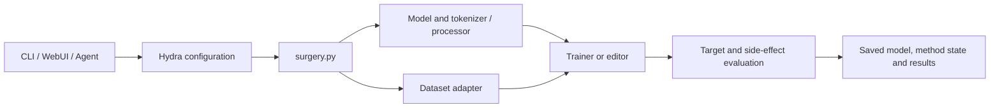

# Architecture / 系统架构

Know-Surgery shares configuration, data loading and results across three public operations: `unlearning`, `inject` and `edit`. CLI, WebUI and Agent requests enter the same router. Each method keeps its own execution mechanism: gradient training, direct weight updates or runtime memory.

## Execution flow

1. Choose a model, dataset, method and evaluation through an experiment YAML or command overrides.
2. Preview the resolved configuration with `--cfg job`.
3. Load the model and data. Text editing converts records to `EditRequest`; training builds supervised or forget/retain batches.
4. Run the selected trainer or editor.
5. Evaluate the target change and unrelated knowledge, then save outputs to the configured directory.

## Code map

| Directory / file | Responsibility |
|---|---|
| `src/know_surgery/` | Installed CLI, shared data contract and Agent runtime |
| `src/surgery.py` | Route the public operation and modality |
| `src/train.py` | Text training and editing lifecycle |
| `src/eval.py` | Standalone text evaluation |
| `src/mm_train.py`, `src/mm_edit.py`, `src/mm_eval.py` | Multimodal execution and evaluation |
| `src/model/` | Load models, tokenizers and processors |
| `src/data/` | Dataset handlers and collators |
| `src/trainer/unlearn/` | Forget/retain training objectives |
| `src/trainer/inject/` | Full and parameter-efficient supervised training |
| `src/trainer/edit/` | Edit requests, methods, execution modes and saved state |
| `src/evals/` | Evaluators, metric aggregation and per-example output |
| `configs/` | Reusable components and complete experiment configurations |
| `webui/backend/`, `webui/frontend/` | Task planning, jobs, logs and result views |
| `.claude/skills/` | Workflows shared by external coding agents |
| `scripts/` | Data preparation, auxiliary training and result processing |

## Configuration layers

`configs/surgery.yaml` chooses an operation. It resolves to `unlearn.yaml`, `inject.yaml` or `edit.yaml`; these compose `model`, `data`, `trainer`, `collator`, `eval` and `paths`. An `experiment` selects a concrete combination and supplies method/model-specific parameters.

Runtime registries in `src/model/__init__.py`, `src/data/__init__.py`, `src/trainer/__init__.py` and `src/evals/__init__.py` connect YAML handler names to Python classes. The catalog in `configs/extensions/` provides recipes and component descriptions for the UI and Agent. Adding YAML is sufficient when an existing handler already implements the required behavior.

## Editing lifecycle

`EditRequest` carries the prompt, subject, new target, optional old target, paraphrases and locality/portability probes. The pipeline supports:

| Mode | Behavior |
|---|---|
| `single` | Apply one request |
| `batch` | Pass a list to the editor; joint solving depends on the method |
| `sequential` | Apply requests successively to the updated model |
| `independent` | Edit, evaluate and restore the original state for each request |

AnyEdit's MEMIT/AlphaEdit ARE backends jointly solve the requests in a batch. IKE's reference demonstration protocol uses one active edit and therefore uses `single` or `independent` mode.

Weight editors change model parameters. IKE and SERAC additionally use runtime memory; WISE has side-memory state. Rank editors may retain statistics, contexts or continuation state. Preserve the whole saved directory when reloading these methods.

## WebUI and Agent

The FastAPI backend launches the same commands available to CLI users and exposes logs and results. The React interface collects inputs and displays those commands. `webui/app.py` provides a Gradio alternative.

The built-in Agent chooses from typed tools and uses their actual responses to decide the next step. External Codex/Claude Code agents can invoke shared Skills. Both use the same model/data/method configurations; neither supplies a separate algorithm backend.

See [configuration](experiments.md), [components](components.md) and [editing](editing.md) for usage.
