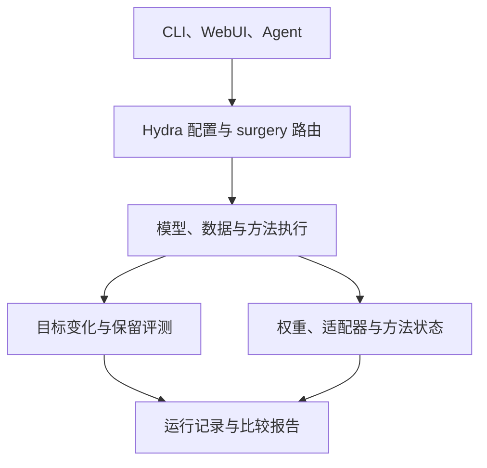

# Know-Surgery 仓库导读

本文按一次知识更新实验的执行顺序说明核心模块、配置、界面和运行产物。

## 1. 先理解一次实验

Know-Surgery 的研究对象是知识增加、删除和修改。CLI、WebUI、内置 Agent、外部 coding Agent 都在组织这些实验；它们最终复用同一组模型、数据、方法和评测配置。

`operation=edit` 是实验目标；`trainer=edit/FT` 是实现方法；`model=gpt2` 是承载知识的模型；`data.edit` 是待修改知识；`eval` 是判断目标变化及副作用的程序。把它们分开，才能在更换方法时复用模型、数据和评测。

模型、数据、方法与评测配置位于 `configs/`；19 个共享 Skills 位于 `.claude/skills/`。配置或工作流存在，不代表所有组合都已完成模型验证。

## 2. 核心代码 src/

### 对外入口与编排

| 文件 | 职责 | 理解时关注什么 |
|---|---|---|
| `know_surgery/cli.py` | 安装后的 `know-surgery` 命令，分发 agent/export-skills/实验操作 | 安装包的门面 |
| `know_surgery/__main__.py` | `python -m know_surgery` | 与 CLI 共用入口 |
| `surgery.py` | 读取 operation/modality，组合 Hydra 配置，选择文本或多模态入口 | 统一路由，不实现算法 |
| `train.py` | 文本任务完整生命周期：准备、执行、保存、评测、记录 | 注入/遗忘训练与知识编辑在此分支 |
| `eval.py` | 加载保存的模型及方法状态、解析独立评测输入、运行 evaluator | 对已有实验重新评测 |
| `mm_train.py`、`mm_edit.py`、`mm_eval.py` | 多模态训练、编辑与评测生命周期 | 处理 processor、图片输入及图文指标 |
| `know_surgery/data_contract.py` | 校验并规范化知识记录、保留来源和时间等元数据 | 保留字段不等于自动理解并验证时间语义 |
| `know_surgery/resources.py` | 在源码安装或 wheel 中定位 configs | 脱离仓库目录也能读取配置 |
| `know_surgery/skill_export.py` | 导出共享 Skills 与运行脚本 | 帮助外部 Agent 使用工作台 |

三个公开操作名固定为 `unlearning`、`inject`、`edit`。内部路径用 `unlearn`，例如 `saves/unlearn/`，这是 operation 名与内部 mode 名的区别。

当前公开路由中，多模态支持 `unlearning` 和 `edit` 的实验性路径，没有多模态注入路由。使用前核对具体模型、processor 和方法要求。

### 模型与数据层

`src/model/` 负责加载模型、tokenizer、processor、精度和模板。模型能通过 AutoModel 加载，不代表每个编辑器都知道它的可编辑层；ROME/MEMIT/AlphaEdit 等仍需要精确映射。

`src/data/` 把原始数据变成方法能处理的样本：

| 模块 | 主要内容 |
|---|---|
| `editing.py` | 通用编辑样本及 CounterFact、zsRE、ELKEN、UnKE、AKEW、LEME 等适配 |
| `inject.py` | Alpaca/ShareGPT 等监督训练格式、prompt/answer 分隔与 token mask |
| `qa.py`、`pretraining.py` | QA 或文本续写样本 |
| `unlearn.py` | 遗忘集与保留集的配对、采样 |
| `multimodal.py`、`mm_editing.py`、`clear_dataset.py` | 图文样本、图像路径及多模态 benchmark 适配 |
| `collators.py` | 把单条样本拼成 batch，补齐长度、mask、ReFT 干预位置 |
| `__init__.py` | 根据配置中的 handler 名找到实际 Python 类 |

自由文本转换目前主要是字段映射、格式检查、空行切分和来源保留。事件的有效期、规则冲突、过程依赖、独立评测问答的语义正确性，需要额外任务协议与质量检查。

### 方法层 trainer/

| 子目录 | 所做工作 | 使用前提 |
|---|---|---|
| `unlearn/` | GradAscent、GradDiff、NPO、SimNPO、RMU 等遗忘目标 | 正确的初始模型、forget/retain 数据和必要参考模型 |
| `inject/` | 全量 FT、LoRA、DoRA、AdaLoRA、LoReFT | 新知识训练数据、独立测试数据、保存后的 adapter/干预恢复 |
| `edit/` | FT、ROME、MEMIT、AlphaEdit、AnyEdit、IKE、GRACE、WISE、SERAC 等 | 方法变体、层映射、统计缓存、辅助网络、运行状态 |

`edit/base.py` 的 `EditRequest` 描述 prompt、subject、新旧答案、改写问法、locality/portability 等。新增算法应优先实现这个接口并声明适用条件，而不是自己再写一套数据读取与结果格式。

编辑模式也必须区分：`single` 一条；`batch` 一次传入列表，是否联合求解取决于方法；`sequential` 在已编辑模型上累计修改；`independent` 每条编辑后评测并恢复。它们产生的分数回答不同实验问题。

当前 ROME/MEMIT/AlphaEdit 已有 `native_adapted` 与 `official_reference` 配置。参考配置存在，并不能替代原论文规模和协议的复现证据。MEND/MALMEN/InstructEdit 等仍有 compact/checkpoint-specific 条件；SERAC 与 SERACCompact 也应分别标注。

### 评测与保存

`src/evals/` 负责产生知识更新效果证据。编辑通常看目标、改写泛化、locality、portability；注入看目标任务表现和保留知识；遗忘使用 TOFU/MUSE/MLLMU/CLEAR 等各自协议。`metrics/` 中还包含记忆、隐私/MIA、utility 指标。

编辑 reliability 的 teacher-forced token accuracy，不等于模型自由生成完整答案的成功率。TOFU FQ 是统计检验 p 值，不是“遗忘百分比”。没有评测数据时应记录 unavailable，不能写成模型得了 0 分。

`trainer/edit/artifacts.py`、`checkpoint_identity.py`、`rank_state.py` 负责保存/验证编辑状态。对于 IKE/GRACE/WISE/SERAC，模型权重往往不足以重建更新后的行为；还要保留 memory、adapter、辅助网络与 tokenizer 身份。

## 3. configs/：如何装配实验

| 目录 | 含义 | 例子 |
|---|---|---|
| `model/` | 模型、tokenizer/processor、模板、精度 | `gpt2.yaml` |
| `data/datasets/` | 数据 handler、来源、split、字段、路径 | `CounterFact_edit.yaml` |
| `trainer/` | 方法类、训练参数、算法专属参数 | `edit/FT.yaml`、`inject/LoRA.yaml` |
| `eval/` | evaluator 与指标、参考输入 | `edit.yaml`、`tofu.yaml` |
| `collator/` | batch 构造方式 | 监督训练或 ReFT |
| `experiment/` | 可复用的模型+数据+方法+评测组合 | `edit/model_coverage/gpt2_ft_counterfact` |
| `paths/`、`hydra/`、`accelerate/` | 输出路径、Hydra 行为、多进程配置 | 通常先复用默认配置 |
| `extensions/` | UI/Agent 目录、精选配方、兼容性元数据 | `recipes.yaml`、`edit_model_matrix.yaml` |

需要区分三种“注册”：Python registry 决定某类能否执行；YAML 决定使用什么参数；catalog/compatibility 决定界面能发现什么、组合具有何种证据。只加一个 YAML 不会自动实现新算法。

`src/extension_registry.py` 负责扩展清单/ZIP结构与配置校验；`edit_registry.py` 负责文本模型-编辑方法组合；`mm_registry.py` 负责多模态方法/模型/benchmark 条件。它们分别描述扩展安装、文本编辑兼容性和多模态运行条件。

## 4. webui/：React 界面与 FastAPI 后端

React 页面在 `frontend/src/pages/`：Workbench 选任务、数据、计划和执行；Runs 看进程、日志、结果；Compare 对比实验；Extensions 浏览组件和 Skills。

FastAPI 后端在 `backend/`：`app.py` 暴露 API 并托管前端，`catalog.py` 读取组件/构造命令，`schemas.py` 校验请求，`planner.py` 生成计划，`jobs.py` 管理子进程，`uploads.py` 处理上传与数据接入，`results.py` 读取产物/状态/比较。

`backend/data_import.py` 为上传功能提供有大小限制的 JSON、JSONL、CSV 解析与规范化，并复用 `know_surgery/data_contract.py` 校验操作字段。上传输入先预览，再生成配置；模型权重与执行命令仍由统一入口处理。

## 5. Agent、Skills 与 scripts/

内置 Agent 在 `src/know_surgery/agent.py`，提供 OpenAI 和 DeepSeek 两种 provider 配置，选择 12 个预定义工具，处理计划、数据准备、限定运行、结果和报告。它不执行任意 provider 生成的 shell。

19 个共享 Skills 位于 `.claude/skills/`，`.agents/skills` 指向同一处。按工作阶段分组：

| 阶段 | Skills |
|---|---|
| 准备与计划 | setup-env、inspect-repo、plan-surgery |
| 规范化输入 | normalize-knowledge、build-cases |
| 扩展接入 | add-model、add-dataset、add-multimodal-case |
| 执行 | run-inject、run-unlearn、run-edit、smoke-test、batch-sweep |
| 结果与复现 | aggregate-results、compare-methods、generate-report、reproduce-run |
| 维护 | debug-ui、release-checklist |

大多数 Skills 的脚本只是薄封装，实际调用 `scripts/skill_runtime.py`。Skills 描述工作流；runtime 实现确定性操作；Agent 决定如何组合这些操作。三者不能都叫“Agent 算法”。

其他 scripts 包括辅助编辑网络训练、SERAC 训练、memory-editor 数据准备、多模态梯度 mask、独立遗忘评测及扩展校验。它们不是统一路由的替代品，而是某些方法运行前后的专门步骤。

## 6. demos、docs、环境与运行产物

`demos/` 提供小型输入样例。示例数据帮助理解格式，并不自动构成论文 benchmark。`docs/` 面向使用者和扩展开发者。`setup.py`/`pyproject.toml`/`MANIFEST.in` 管理 Python 分发，requirements/lock 管理依赖，Dockerfile 构建带前端的源码环境，LICENSE/THIRD_PARTY_NOTICES/LICENSES 保存项目和上游归属。

运行后会出现两类目录：`artifacts/` 保存计划、Agent trace、UI任务状态；`saves/` 保存具体实验。一个完整实验应保留 command、resolved_config、environment、input_manifest、run_trace、逐样本预测、summary，以及恢复模型所需的完整状态。

## 7. 建议的阅读顺序

1. 先读 README，预览一条 GPT-2 FT 编辑配置。
2. 读 `configs/surgery.yaml`、`src/surgery.py`，理解路由。
3. 顺着一个 experiment 读 model/data/trainer/eval YAML。
4. 读 `data/editing.py` 的样本接口与 `trainer/edit/base.py` 的方法接口。
5. 看 `train.py` 如何执行/评测/保存，再看 `evals/edit.py` 的指标定义。
6. 再读 Agent 和 WebUI，理解它们如何调用已有链路。
7. 要实现新方法时，再深入对应算法文件、状态恢复和小样本验证。

具体运行前提见 [组件接入](components.md)、[编辑方法](editing.md) 和 [评测说明](evaluation.md)。
